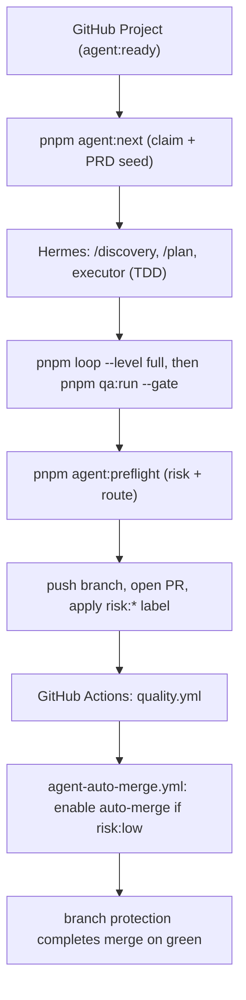

# 24/7 agent runtime with GitHub Projects

This runbook wires an unattended agent (Hermes) to a GitHub Project so it completes issues
sequentially, with autonomy routed by risk. The trust model is preserved: the agent never
decides the merge. CI revalidates every PR and branch protection gates `main`. Auto-merge is
only enabled for low-risk PRs and still waits for required checks.

See [trust-model.md](./trust-model.md) and [human-in-the-loop.md](./human-in-the-loop.md)
for the principles, and [hermes.md](./hermes.md) for the Hermes adapter.

## Architecture



## One-time GitHub setup

1. Create the labels (idempotent):

   ```bash
   pnpm agent:setup-labels            # uses .github/agent-labels.json and gh
   ```

2. Create a GitHub Project (v2) and add a board with at least a column for ready work.
   Tag issues to be automated with `agent:ready` (the issue form does this automatically).

3. Enable auto-merge in the repository: Settings -> General -> "Allow auto-merge".

4. Protect `main`: Settings -> Branches -> add a rule for `main`:
   - Require a pull request before merging.
   - Require status checks to pass: select `Deterministic quality` (and `Cross-model QA gate`).
   - Require branches to be up to date.
   This is what makes `--auto` safe: the merge only completes when these checks pass.

5. Provide credentials to CI (optional QA): add repository secret `QA_REVIEW_JSON_B64` if you
   want a strict cross-model QA gate in CI; otherwise the gate runs in optional mode.

## Hermes setup (on Hermes infra)

1. Project context and skills come from this repo. Project the skills and config:

   ```bash
   pnpm ai:sync                       # writes .hermes/skills, .hermes/config.yaml, .hermes/AGENTS.md
   ```

2. Configure the model in `~/.hermes/config.yaml` (or `hermes model <provider:model>`), and
   put secrets in `~/.hermes/.env`. Use one model for implementation and a different one for QA.

3. Give Hermes a GitHub token with `repo` and `project` scope (a GitHub App installation token
   or a fine-grained PAT for a bot account). `gh` must be authenticated in its environment.

4. Run the loop. Each iteration handles exactly one issue:

   ```bash
   pnpm agent:next          # claim next ready issue -> writes ai/workspace/prds/issue-N.md
   # Hermes runs /agent-run (discovery -> plan -> execute -> loop -> qa -> preflight -> PR)
   ```

   Schedule it sequentially (cron, a service loop, or Hermes' own scheduler). Do not run two
   iterations concurrently; the claim step relabels `agent:ready -> agent:in-progress` to keep
   work serial.

## Risk routing

`pnpm agent:preflight` re-derives risk from the real diff (it does not trust the issue hint)
and writes `.quality/agent-preflight.json` with `risk` and `route`.

| Risk | Trigger | Route |
| --- | --- | --- |
| `high` | secrets, auth/security, dependency or lockfile changes, migrations, SQL, CI/infra, or any edit to `quality/baselines/` or generated vendor files | human |
| `medium` | new business logic, more than one source area, change size above the low thresholds, or source changed without test changes | human |
| `low` | small, single-area, tested change with no risky paths | auto-merge candidate |

`route` is `auto` only when risk is `low` and no verification signal is failing. Anything else
sets `agent:needs-human`.

## Stop conditions (agent sets agent:needs-human and stops)

From [human-in-the-loop.md](./human-in-the-loop.md): ambiguous requirements, plan grows beyond
one reviewable slice, validation requires scope change, secrets/data/production access, or the
change would grow a quality baseline. `pnpm loop` reaching `stop` or `pnpm qa:run` returning
`stop` also halts the agent.

## What is automated vs human

- Automated: claiming work, discovery/plan drafts, TDD implementation, deterministic gates,
  self-correction loop, cross-model QA, risk classification, opening the PR, and auto-merge for
  low-risk green PRs.
- Human: ambiguous scope, risky trade-offs, baseline changes, and the merge of every
  medium/high-risk PR.
